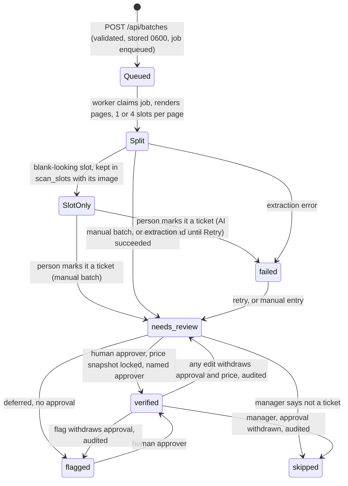
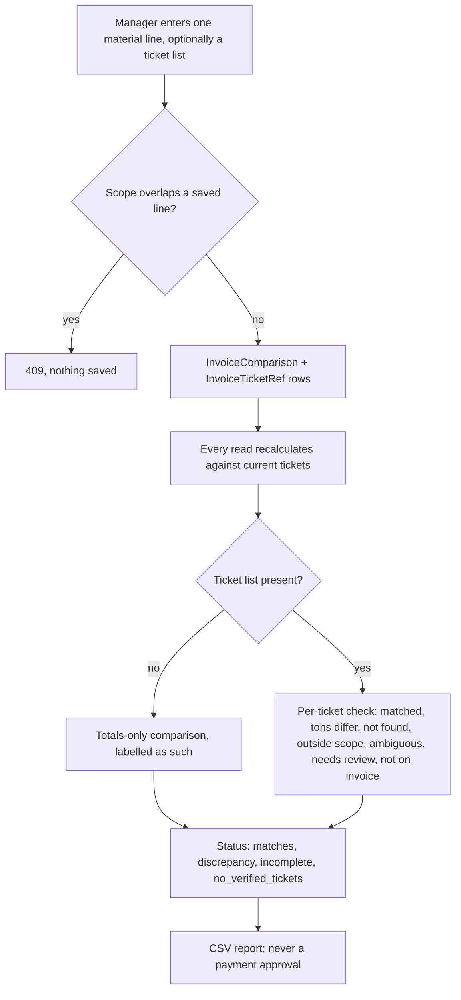
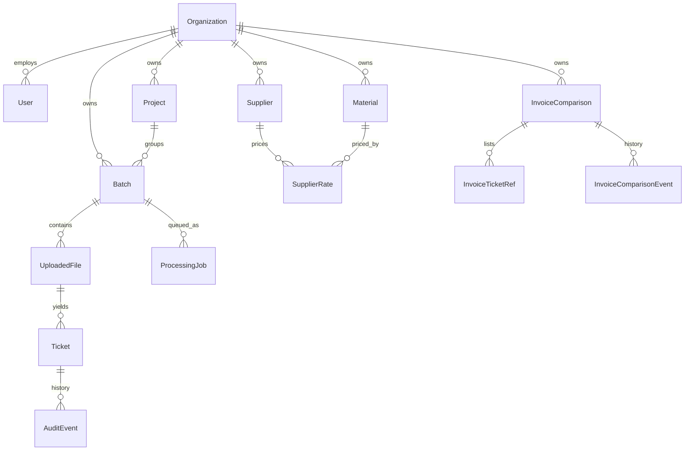

# Ticketflow engineering audit — November 2026

Audited at branch `feature/m0-engineering-audit`, stacked on `feature/invoice-ticket-matching` (`eec4349`), which is itself one unmerged commit ahead of `main` (`ecbf428`). Everything here comes from reading the code and running it locally. Nothing was measured on real tickets.

## Corrections to the brief and competitive audit

| The brief/audit says | What the code shows |
|---|---|
| No ticket-number invoice line matching | Built and tested on `feature/invoice-ticket-matching` (PR not merged yet). Milestone 4 extends it and doesn't rebuild it. |
| `main` is the base | New work is stacked on the invoice branch so the Alembic chain stays linear. Merge in order. |
| Gemini/Anthropic adapters | Correct. Gemini is the default. The Upload page still told people to set `ANTHROPIC_API_KEY` (fixed in Milestone 1). |
| A permission test guards every mutating route | The test existed but **passed without checking anything** on FastAPI 0.162, because included routers no longer appear as `APIRoute` in `app.routes`. Fixed in this milestone. |
| Local clones | The repo is the inner `ticketflow/ticketflow`. The outer `ticketflow/` folder holds older `backend/` and `frontend/` copies and should not be used. |

## Test baseline (before Milestone 1 changes)

| Suite | Command | Result |
|---|---|---|
| Backend | `cd backend && python -m pytest -q` | 209 passed (FastAPI 0.162, Python 3.13) |
| Frontend build | `npm run build` on Node 22 | Passed |
| Browser | `npx playwright test --config tests/playwright.config.mjs` | 27 passed, mocked API |

No lint or type-check script exists beyond `next build`. Node 23 breaks the build, so Node 22 is pinned.

## Ticket lifecycle

Guards that hold today and have tests: approval requires all fields present; an identical crop already approved in the company returns 409; a repeated verify doesn't reprice; a retry never overwrites a non-failed ticket; jobs recover after a crash without touching finished files.

## Invoice reconciliation lifecycle

## Data model (relationships)

Tickets reach a company only through `Batch.organization_id`. `Ticket.supplier` and `material_type` are free text compared with `pricing.norm`, not foreign keys to the catalog. `Ticket.tonnage` is tons only, by convention and the extraction prompt: no unit column exists.

## Endpoint / role matrix

Generated by `python backend/scripts/route_matrix.py`; regenerate it when routes change. Every read is also scoped to the signed-in user's company. Cross-company IDs return 404.

| Method | Path | Permission | Owner | Manager | Clerk | Viewer |
|---|---|---|---|---|---|---|
| POST | `/api/auth/login` | self | yes | yes | yes | yes |
| POST | `/api/auth/logout` | self | yes | yes | yes | yes |
| GET | `/api/auth/me` | self | yes | yes | yes | yes |
| POST | `/api/auth/password` | self | yes | yes | yes | yes |
| GET | `/api/batches` | signed in (company-scoped read) | yes | yes | yes | yes |
| POST | `/api/batches` | tickets.upload | yes | yes | yes | — |
| GET | `/api/batches/{batch_id}` | signed in (company-scoped read) | yes | yes | yes | yes |
| PUT | `/api/batches/{batch_id}/expected-count` | tickets.upload | yes | yes | yes | — |
| GET | `/api/batches/{batch_id}/export.xlsx` | signed in (company-scoped read) | yes | yes | yes | yes |
| GET | `/api/batches/{batch_id}/manifest` | signed in (company-scoped read) | yes | yes | yes | yes |
| POST | `/api/batches/{batch_id}/manifest/rebuild` | tickets.upload | yes | yes | yes | — |
| POST | `/api/batches/{batch_id}/retry` | tickets.upload | yes | yes | yes | — |
| GET | `/api/batches/{batch_id}/scan-events` | signed in (company-scoped read) | yes | yes | yes | yes |
| GET | `/api/batches/{batch_id}/tickets` | signed in (company-scoped read) | yes | yes | yes | yes |
| GET | `/api/dashboard` | signed in (company-scoped read) | yes | yes | yes | yes |
| GET | `/api/files/{file_id}/pages/{page_no}/image` | signed in (company-scoped read) | yes | yes | yes | yes |
| GET | `/api/invoice-comparisons` | signed in (company-scoped read) | yes | yes | yes | yes |
| POST | `/api/invoice-comparisons` | invoices.manage | yes | yes | — | — |
| GET | `/api/invoice-comparisons/{line_id}` | signed in (company-scoped read) | yes | yes | yes | yes |
| PUT | `/api/invoice-comparisons/{line_id}` | invoices.manage | yes | yes | — | — |
| GET | `/api/invoice-comparisons/{line_id}/audit` | signed in (company-scoped read) | yes | yes | yes | yes |
| GET | `/api/invoice-comparisons/{line_id}/report.csv` | signed in (company-scoped read) | yes | yes | yes | yes |
| POST | `/api/invoice-comparisons/{line_id}/ticket-links` | invoices.manage | yes | yes | — | — |
| POST | `/api/invoice-comparisons/{line_id}/ticket-links/{link_id}/release` | invoices.manage | yes | yes | — | — |
| GET | `/api/invoice-documents` | signed in (company-scoped read) | yes | yes | yes | yes |
| POST | `/api/invoice-documents` | invoices.manage | yes | yes | — | — |
| GET | `/api/invoice-documents/{document_id}` | signed in (company-scoped read) | yes | yes | yes | yes |
| GET | `/api/invoice-documents/{document_id}/history` | signed in (company-scoped read) | yes | yes | yes | yes |
| POST | `/api/invoice-documents/{document_id}/lines` | invoices.manage | yes | yes | — | — |
| PATCH | `/api/invoice-documents/{document_id}/lines/{line_id}` | invoices.manage | yes | yes | — | — |
| POST | `/api/invoice-documents/{document_id}/lines/{line_id}/confirm` | invoices.manage | yes | yes | — | — |
| POST | `/api/invoice-documents/{document_id}/lines/{line_id}/reject` | invoices.manage | yes | yes | — | — |
| GET | `/api/invoice-documents/{document_id}/original` | signed in (company-scoped read) | yes | yes | yes | yes |
| GET | `/api/invoice-documents/{document_id}/pages/{page_no}/image` | signed in (company-scoped read) | yes | yes | yes | yes |
| POST | `/api/invoice-documents/{document_id}/void` | invoices.manage | yes | yes | — | — |
| GET | `/api/materials` | signed in (company-scoped read) | yes | yes | yes | yes |
| POST | `/api/materials` | pricing.manage | yes | yes | — | — |
| DELETE | `/api/materials/{mid}` | pricing.manage | yes | yes | — | — |
| GET | `/api/name-aliases` | signed in (company-scoped read) | yes | yes | yes | yes |
| POST | `/api/name-aliases` | pricing.manage | yes | yes | — | — |
| DELETE | `/api/name-aliases/{alias_id}` | pricing.manage | yes | yes | — | — |
| GET | `/api/pricing/history` | signed in (company-scoped read) | yes | yes | yes | yes |
| GET | `/api/projects` | signed in (company-scoped read) | yes | yes | yes | yes |
| POST | `/api/projects` | projects.manage | yes | yes | — | — |
| PATCH | `/api/projects/{pid}` | projects.manage | yes | yes | — | — |
| GET | `/api/rates` | signed in (company-scoped read) | yes | yes | yes | yes |
| PUT | `/api/rates` | pricing.manage | yes | yes | — | — |
| DELETE | `/api/rates/{rid}` | pricing.manage | yes | yes | — | — |
| GET | `/api/records` | signed in (company-scoped read) | yes | yes | yes | yes |
| GET | `/api/records/export.xlsx` | signed in (company-scoped read) | yes | yes | yes | yes |
| GET | `/api/reports/pilot` | signed in (company-scoped read) | yes | yes | yes | yes |
| GET | `/api/reports/pilot.csv` | signed in (company-scoped read) | yes | yes | yes | yes |
| POST | `/api/review-timings` | tickets.edit | yes | yes | yes | — |
| POST | `/api/scan-slots/{slot_id}/confirm-blank` | scans.confirm_blank | yes | yes | — | — |
| GET | `/api/scan-slots/{slot_id}/image` | signed in (company-scoped read) | yes | yes | yes | yes |
| POST | `/api/scan-slots/{slot_id}/mark-ticket` | scans.resolve | yes | yes | yes | — |
| POST | `/api/scan-slots/{slot_id}/rotate` | scans.resolve | yes | yes | yes | — |
| GET | `/api/suppliers` | signed in (company-scoped read) | yes | yes | yes | yes |
| POST | `/api/suppliers` | pricing.manage | yes | yes | — | — |
| DELETE | `/api/suppliers/{sid}` | pricing.manage | yes | yes | — | — |
| GET | `/api/team/events` | team.manage | yes | — | — | — |
| GET | `/api/team/members` | team.manage | yes | — | — | — |
| POST | `/api/team/members` | team.manage | yes | — | — | — |
| PATCH | `/api/team/members/{member_id}` | team.manage | yes | — | — | — |
| POST | `/api/team/members/{member_id}/reset-password` | team.manage | yes | — | — | — |
| PATCH | `/api/tickets/{ticket_id}` | tickets.edit | yes | yes | yes | — |
| GET | `/api/tickets/{ticket_id}/audit` | signed in (company-scoped read) | yes | yes | yes | yes |
| POST | `/api/tickets/{ticket_id}/flag` | tickets.flag | yes | yes | yes | — |
| GET | `/api/tickets/{ticket_id}/image` | signed in (company-scoped read) | yes | yes | yes | yes |
| POST | `/api/tickets/{ticket_id}/skip` | tickets.skip | yes | yes | — | — |
| POST | `/api/tickets/{ticket_id}/verify` | tickets.verify | yes | yes | — | — |

`GET /api/status` (signed in) and `GET /health` (public, no data) are declared directly in `main.py`.

## Which invariants have tests

| Invariant | Status | Evidence |
|---|---|---|
| Human approval of tons | Tested | `test_review_workflow`, `test_verification_integrity` |
| Missing values stay null; no false match | Tested for values and invoices | `test_edge_case_guardrails`, `test_invoice_comparisons` |
| Missing physical tickets are visible | Tested (Milestone 1) | `test_scan_manifest` |
| No repricing | Tested | `test_price_snapshots` |
| Double counting: identical scan | Tested | `test_edge_case_guardrails` |
| Double counting: same ticket, different scan | Advisory warning only | `duplicates.py` |
| Traceability to scan, page, crop, approver | Tested at ticket level | `Ticket.source_page`, `position`, `crop_box`; export approver columns |
| Permission on every mutating route | **Was vacuous; fixed here** | `test_every_mutating_api_route_declares_a_permission` |
| Anonymous requests rejected on every route | **Added here** | `test_every_api_route_rejects_anonymous_requests` |
| Tenant isolation of existing routes | Tested for the main objects | `test_organization_isolation`, not a generated per-route check |
| Concurrent claims on one ticket | Tested on SQLite with real threads | `test_concurrent_claims_on_one_ticket_produce_one_link`. Not yet run on PostgreSQL |
| Concurrency on ticket approval | **Untested** | Relies on SQLite serializing writes |
| Units other than tons | Blocked by prompt and parser only | `extraction.py`, `validation.py` |

## Prioritized risk register

| # | Risk | Severity | Where | Plan |
|---|---|---|---|---|
| 1 | A faint or misjudged slot is discarded, so a total looks complete while missing a delivery | **High** | `pipeline.py`, `splitter.is_blank` | Milestone 1 |
| 2 | Failed files don't affect invoice status | **High** | `routers/invoices.py` | Milestone 1 |
| 3 | Guard test was vacuous; version ranges allow silent framework changes | **High** (fixed), Medium (ranges) | `test_team_accounts`, `requirements.txt` | Fixed here; a lock file is a follow-up |
| 4 | Supplier name variants defeat rate lookup and invoice scope | Medium | `pricing.norm` | Milestone 2 |
| 5 | Invoice lines are typed by hand | Medium (adoption) | `routers/invoices.py` | Milestone 3 |
| 6 | The same ticket can be listed on two lines; only a warning at read time, no durable claim | **High** | `invoice_matching.py` | Fixed in Milestone 4: database-enforced single active link |
| 7 | No intake or reconciliation report with drill-down | Medium | `reports.py` | Fixed in Milestone 5 |
| 8 | Each invoice line scans the project's tickets in Python; the duplicate check is quadratic when many tickets are identical loads | Medium | `routers/invoices.py`, `duplicates.py` | Measured in `pilot-readiness.md`. Acceptable at pilot size; fix before large customers |
| 9 | Missing crop file returned a 500 | Low | `routers/api.py` | Fixed in Milestone 1 |
| 12 | `/api/dashboard` sent Decimals as JSON floats because it returned a plain dict | Medium | `routers/reports.py` | Fixed in Milestone 5 |
| 10 | Real handwriting accuracy unmeasured | **High** (business) | `EVALUATION.md` | **Blocked: needs permissioned tickets** |
| 11 | Hosted-deployment blockers | **High** (before hosting) | `SECURITY_PRELAUNCH.md` | Out of scope; Milestone 6 design only |

## Implementation checklist

- [x] Milestone 0: audit, baseline, guard test fix
- [x] Milestone 1: scan completeness and crop integrity
- [x] Milestone 2: supplier and material aliases
- [x] Milestone 3: invoice PDF to draft lines (text-layer reader; AI reader blocked on budget and permission)
- [x] Milestone 4: durable ticket claims on invoice lines (full-ticket only; partial allocation deliberately unsupported)
- [x] Milestone 5: pilot report, demo, documentation
- [x] Milestone 6: [hosted architecture proposal](hosted-architecture-proposal.md) (design only; nothing provisioned)
